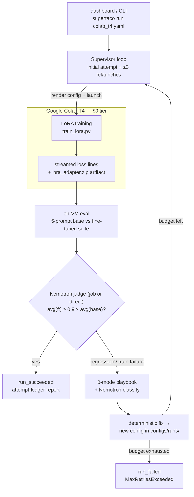
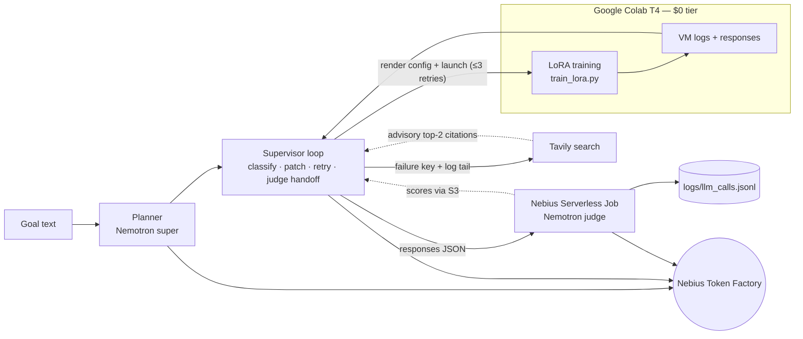

# SuperTaco

**AI-supervised fine-tuning sandbox** — Nebius x NVIDIA Global AI Hackathon.

Give it a config (or a plain-English goal) and SuperTaco runs the whole loop: LoRA training on
a **free Google Colab T4**, live log streaming, automatic failure diagnosis (NaN loss, OOM,
divergence, eval regression, ...), config patching and relaunch (up to 3 times), then a
before/after comparison scored by an NVIDIA **Nemotron** judge running as a **Nebius
Serverless Job** — with a labeled fallback to direct Token Factory judging if the cloud
path fails. Every attempt, event, and score is surfaced in a Streamlit attempt-ledger
dashboard and written to an append-only audit log.

Three Nebius/NVIDIA surfaces, all live:

| Surface | Role | Where |
|---|---|---|
| Google Colab T4 (free) | LoRA training GPU | `colab/train_lora.py` via `ColabTransport` |
| Nebius Token Factory | Nemotron LLM API (judge, classifier, patcher — called by the host **and** inside the judge job) | `supertaco/agent/llm.py`, `supertaco/eval/judges.py`, `supertaco/gpu/judge_job.py` |
| Nebius Serverless Jobs | Eval-as-a-job: the judge runs on Nebius CPU compute | `supertaco/gpu/nebius_jobs.py`, `supertaco/eval/nebius_backend.py` |

---

## Table of contents

1. [How it works](#how-it-works)
2. [Judge-as-a-Nebius-Job (deep dive)](#judge-as-a-nebius-job-deep-dive)
3. [Quick start](#quick-start)
4. [CLI reference](#cli-reference)
5. [Configuration](#configuration)
6. [Goal-driven runs](#goal-driven-runs)
7. [Failure playbook](#failure-playbook)
8. [NVIDIA & Nebius usage](#nvidia--nebius-usage)
9. [Dashboard](#dashboard)
10. [Environment variables](#environment-variables)
11. [Testing & hermeticity](#testing--hermeticity)
12. [Live verification evidence](#live-verification-evidence)
13. [Repository map](#repository-map)
14. [Troubleshooting & known gotchas](#troubleshooting--known-gotchas)
15. [Status](#status)

---

## How it works



Design principles, enforced in code and tests:

- **Labeled degradation, never silent fallback.** Every degraded path is visible: the judge
  falls back to direct scoring with `judge_backend: direct_fallback` + a dashboard warning;
  LLM API errors trip a circuit breaker and fall back to hash scores marked `fallback`.
- **Immutable configs.** Every patch creates a new file in `configs/runs/`; the original is
  never edited. Every LLM call appends to `logs/llm_calls.jsonl` (model, mode, tokens,
  latency, error) for audit.
- **Fail fast on infra, retry on science.** Validation/infra errors end the run immediately
  with an actionable `run_failed` and the VM is always stopped; *detectable training*
  failures (OOM, NaN, ...) get classified, patched, and relaunched within the retry budget.

---

## Judge-as-a-Nebius-Job (deep dive)

This is the WS1.2 feature: the eval judge is not a local loop — it is a real Nebius
Serverless Job. One `judge()` call executes this pipeline:

```
host (NebiusJudgeBackend)
  1. MysteryBox: ensure secret "supertaco-tf-key" (payload key TOKEN_FACTORY_API_KEY)
     -> the Token Factory key NEVER appears in the job spec, env list, or logs
  2. S3: ensure bucket "supertaco-judge-artifacts"; presign a PUT URL for scores-<ts>.json
  3. Jobs API: create cpu-d3 / 2vcpu-8gb / 10 GiB job, image python:3.12-slim
     FileInjection (no registry push needed):
        /supertaco/judge_job.py     <- stdlib-only scoring script (zero pip installs)
        /supertaco/responses.json   <- prompts + base + fine-tuned answers
     env: TOKEN_FACTORY_BASE_URL (plain) + TOKEN_FACTORY_API_KEY (MysteryBox ref)
          + SCORES_PUT_URL (presigned) + RESPONSES_PATH
     |
     v
container (judge_job.py)
  4. scores 10 answers (5 prompts x base/ft) via Token Factory, Nemotron Super
  5. PUTs scores.json to the presigned URL, exits
     |
     v
host
  6. polls job to terminal state -> GETs scores.json -> validates the batch shape
  7. merges per-call entries into logs/llm_calls.jsonl with judge_backend: "nebius_job"
     and the real job_id
  8. cleanup, always: delete job resource (even on failure/timeout) + delete S3 object
```

Failure semantics:

- Any infra failure in steps 1-7 raises `JudgeBackendError` → the loop emits a
  `judge_fallback` event with the reason, re-runs the eval via direct Token Factory
  judging, and labels the batch `judge_backend: "direct_fallback"`. The dashboard shows
  "⚠ Nebius judge unavailable — fell back to direct Token Factory judging".
- Job timeout is a hard 15-minute cap; deletion is attempted even on the timeout race.
- Scores payload shape is validated (list lengths == prompt count, all scores numeric)
  before anything is trusted.

Dashboard: the launch panel has a **"Judge on Nebius AI Cloud (serverless job)"** toggle
(default on); the eval report shows **✓ Judged on Nebius AI Cloud** when the job backend
produced the scores.

---

## Quick start

Prerequisites: Python 3.11+, a Google account (one-time Colab auth), a Nebius Token
Factory API key. The Serverless-Job judge additionally needs the `NEBIUS_*` job-path
variables (see [Environment variables](#environment-variables)); without them the judge
falls back to direct Token Factory scoring, clearly labeled.

```bash
git clone https://github.com/1tsDaksh/supertaco.git && cd supertaco
pip install -e .
pip install --group dev

cp .env.example .env
# set NEBIUS_API_KEY (minimum viable); add the NEBIUS_* job-path vars to enable
# the Serverless-Job judge (the CLI/dashboard default)

# one-time Colab auth: run `colab usage` in the google-colab-cli venv
# and open the Google URL - details in colab/README.md

# CLI: real supervisor loop on the default T4 config
# (free GPU, ~10-15 min; spends judge tokens - ask first)
supertaco run configs/defaults/colab_t4.yaml

# Optional: plan a run from a free-text goal, review the yaml, then run it
supertaco plan "answer like a pirate chef"
supertaco run configs/runs/plan_<ts>.yaml

# Optional: after a run, iterate with free-text feedback
supertaco run configs/runs/plan_<ts>.yaml --feedback "be more concise"

# Dashboard: config editor, live timeline + loss chart, attempt-ledger report
streamlit run supertaco/ui/dashboard.py --server.headless true --server.port 8510
```

---

## CLI reference

```
supertaco run <config.yaml> [--feedback "..."] [--judge-backend direct|nebius_job]
supertaco plan "<free-text goal>"
```

| Flag | Default | Meaning |
|---|---|---|
| `--feedback` | off | One Nemotron call revises the plan (same schema + clamps, never-raise keeps the prior plan on parse failure), writes `configs/runs/plan_<ts>_revised.yaml` for audit, then runs. |
| `--judge-backend` | `nebius_job` | Where the eval judge runs. `nebius_job` = Nebius Serverless Job with labeled fallback; `direct` = classic host-side Token Factory judging. |

---

## Configuration

`configs/defaults/colab_t4.yaml`:

```yaml
model: qwen2.5-0.5b     # T4-viable whitelist (see below)
learning_rate: 0.0002
batch_size: 4
lora_r: 8
lora_alpha: 16
lora_dropout: 0.05
num_epochs: 1
chat_template: llama-3
```

- **Model whitelist** (rejected before any GPU is provisioned, with per-model batch caps
  so combinations fit a T4): `Qwen/Qwen2.5-0.5B-Instruct` (batch ≤ 8),
  `TinyLlama/TinyLlama-1.1B-Chat-v1.0`, `Qwen/Qwen2.5-1.5B-Instruct` (batch ≤ 4),
  `Qwen/Qwen2.5-3B-Instruct` (batch ≤ 2). The planner jointly caps batch × grad-accum.
- Training data: a 256-row slice of `yahma/alpaca-cleaned` for the static config; synthetic
  goal-driven datasets are ~135-150 generated rows (see below).
- Generated artifacts: attempt scripts and patched configs in `configs/runs/`, adapter
  zips in `colab/output/`. `configs/base/` is reference-only — never modified.

---

## Goal-driven runs

Instead of a static config, describe what you want the model to learn:

- **Dashboard:** type a goal → **Plan with Nemotron** → review the dataset source
  (synthetic ~150 generated rows, or a named Hugging Face dataset), edit the config knobs
  and the 5 domain eval prompts → **Run**.
- **CLI:** `supertaco plan "answer like a pirate chef"` writes a reviewable
  `configs/runs/plan_<ts>.yaml`; inspect it, then `supertaco run <plan>.yaml`.
- **Iterate:** `supertaco run <plan>.yaml --feedback "be more concise"` (or the dashboard's
  feedback box after a run) — Nemotron revises the plan, synthetic data regenerates from
  the refined goal, and the report shows the before→after judge delta.

The planner is a single Nemotron (super) call (synthetic datasets add chunked
row-generation calls with resume-on-parse-failure); unparseable replies fall back to the
shipped defaults (CLI prints `mode=fallback`; the dashboard warns). The planner emits
exactly 5 judge prompts — the judge scores at most 5.

---

## Failure playbook

Eight data-driven failure modes, each with a deterministic config patch (a new file in
`configs/runs/`, never in-place):

`NAN_LOSS`, `OOM`, `GRADIENT_EXPLOSION`, `LOSS_DIVERGENCE`, `LOSS_PLATEAU`,
`EVAL_REGRESSION`, `TOKENIZER_MISMATCH`, `DATALOADER_STALL`.

- **Retry budget:** initial attempt + max 3 relaunches (4 attempts total). Exhaustion ends
  the run with `run_failed: MaxRetriesExceeded`.
- **Live-proven heal:** a real OOM on a 1.5B goal run was classified, patched (batch halved
  + `gradient_checkpointing: true` honored by the Colab template), and relaunched
  successfully with no human input (2026-10-11).

### Self-researching playbook (Tavily)

On every distinct failure the loop searches Tavily once (`tavily-python`) for the
failure mode + framework and attaches the **top-2 citations** to the patch event,
the attempt ledger, and the dashboard timeline:

```
❌ detected `OOM` → ↳ sources: [Fine-tuning with PEFT ↗](https://huggingface.co/docs/peft), [Optimizing PyTorch training ↗](https://...)
```

Citations are **advisory evidence, never a patch input** — the deterministic playbook
fix stays authoritative. Search calls are audited like every other model call
(`model_key: "tavily"`, `mode: real|fallback` in `logs/llm_calls.jsonl`); with no
`TAVILY_API_KEY` the loop runs with zero Tavily noise.

---

## NVIDIA & Nebius usage

Three surfaces, one audit trail — this is the architecture the demo walks through:



Planner, classifier, patcher, and judge all call **Nebius Token Factory** (Nemotron nano →
super → ultra cost routing, table below); the judge executes as a **Nebius Serverless Job**
(see [Judge-as-a-Nebius-Job deep dive](#judge-as-a-nebius-job-deep-dive)); training babysits a
free Google Colab T4; every metered call — including the optional Tavily lookup — lands in the
audit log above. The three-surface table is at the [top of this README](#super-taco).

### Cost routing

| Role | Model | When |
|---|---|---|
| Failure classification | `nvidia/NVIDIA-Nemotron-3-Nano-30B-A3B` | every detected failure |
| Patch proposal + judge | `nvidia/nemotron-3-super-120b-a12b` | proposal each retry; 10 judge calls per run (5 prompts × base/ft) |
| Deep reason | `nvidia/Nemotron-3-Ultra-550b-a55b` | reserved for novel failures the playbook misses |

- Cost routing starts cheap and escalates only when needed. **Every** call is logged to
  `logs/llm_calls.jsonl` (model, mode=`real`/`fallback`, tokens, latency, error, and for
  job judging: `judge_backend` + `job_id`) for audit.
- On API errors the client trips a 2-strike circuit breaker (60s cooldown, half-open) and
  falls back to simulated/hash scores, clearly marked `fallback` — never silently mixed
  with real results.
- Budget: **$50 Token Factory credits** plus (optional) Nebius Serverless Job CPU minutes —
  these are the only metered resources (Colab T4 training is free). Live runs require
  explicit human approval (AGENTS.md rule 2).

---

## Dashboard

`streamlit run supertaco/ui/dashboard.py` gives:

- **Goal panel** — free-text goal → plan preview (dataset source + 5 eval prompts) → run.
- **Job launcher** — config editor with knob overrides, model dropdown (whitelist only),
  max-retries, and the **"Judge on Nebius AI Cloud (serverless job)"** toggle (default on).
- **Live view** — streaming event timeline, loss chart, raw log tail while the T4 trains.
- **Attempt-ledger report** — per-attempt table (config delta, loss trajectory, status),
  base-vs-fine-tuned judge table with per-cell mode honesty (real / fallback / job),
  the regression verdict, and the **✓ Judged on Nebius AI Cloud** badge when applicable.
- **Feedback box** — after a run, type feedback → re-run with a revised plan and a
  mode-honest before→after delta (the baseline is invalidated on manual re-runs).

---

## Environment variables

All in `.env` (gitignored, never committed). `import supertaco.settings` loads it without
overriding already-set process variables — keep your shell clean of stale
`NEBIUS_*` / `TOKEN_FACTORY_*` values.

| Variable | Required for | Notes |
|---|---|---|
| `NEBIUS_API_KEY` | everything LLM | Token Factory key: judge, classifier, patcher (host) and the job's in-container judge calls (via MysteryBox). |
| `TOKEN_FACTORY_BASE_URL` | LLM calls | e.g. `https://api.tokenfactory.nebius.com/v1`. |
| `NEBIUS_SERVICE_ACCOUNT_ID`, `NEBIUS_PUBLIC_KEY_ID`, `NEBIUS_PRIVATE_KEY_FILE`, `NEBIUS_PROJECT_ID` | Serverless-Job judge | Authorized-key pair auth for the Nebius SDK (Jobs + MysteryBox). Private key stays on disk; the SDK signs token exchanges with it. |
| `NEBIUS_S3_ACCESS_KEY_ID`, `NEBIUS_S3_SECRET_KEY`, `NEBIUS_S3_ENDPOINT` | Serverless-Job judge | S3-compatible Object Storage for the scores handoff. Endpoint form: `https://storage.<region>.nebius.cloud`. |
| `TAVILY_API_KEY` | optional | Error-context research in the playbook. |

Missing any Serverless-Job variable is not fatal: the judge falls back to direct Token
Factory scoring, labeled `direct_fallback`. Use `--judge-backend direct` (CLI) or the
dashboard toggle to skip the job path entirely.

---

## Testing & hermeticity

```bash
python -m pytest tests/ -q                # 286 tests - transport and LLM faked, no network/credits
python -m ruff check .                    # lint
python -m ruff format --check supertaco tests
python -m mypy supertaco/                 # clean (22 files)
```

- The whole suite is **audit-hermetic**: an autouse fixture (`tests/conftest.py`) redirects
  every audit-log writer to a tmp dir, so a full-suite run leaves
  `logs/llm_calls.jsonl` byte-for-byte unchanged (delta-0 is enforced as a gate).
- Dashboard tests run Streamlit `AppTest` with the judge toggle seeded off and
  `NebiusJudgeBackend` monkeypatched — a regression that would touch the real cloud fails
  a guard test instead of spending credits.
- Only documented, user-approved live smokes touch Token Factory / Jobs / S3.

---

## Live verification evidence

Everything above is not just unit-tested — it has run for real (details in the local
`docs/WS12_LIVE_SMOKE.md` + `logs/llm_calls.jsonl`):

- **Judge-as-a-job smoke (2026-10-16):** job `aijob-e04wgsj23r9e9vg3p1` —
  `PROVISIONING → STARTING → IMAGE_PULLING → RUNNING → COMPLETED` in 237s,
  10/10 real Nemotron Super judge calls (base avg 4.8 vs fine-tuned avg 8.2 on canned
  answers), scores handed off via presigned S3 PUT/GET, job + S3 object deleted,
  audit entries carry `judge_backend: "nebius_job"` + the real `job_id`.
  A first attempt failed honestly on an S3 quota (`direct_fallback` path preserved the
  run), root-caused and fixed by forcing the bucket to the `ENHANCED_THROUGHPUT` storage
  class.
- **Full goal-driven training smoke (2026-10-11):** pirate-chef goal → synthetic 135-row
  dataset → Colab T4 attempt 1, loss 3.70 → 1.66, `[run_succeeded]`, 10/10 real judge
  calls, VM stopped.
- **Self-heal smoke (2026-10-11):** live OOM on a 1.5B run → classified → patched →
  relaunched → succeeded, zero human input.
- **Feedback-iteration smoke (2026-10-13):** dashboard feedback re-run with before→after
  judge delta; also flushed out (and fixed) a cp1252/Unicode prompt-key bug with a
  regression test that reproduces the exact live error.

---

## Repository map

```
supertaco/
  cli.py                 run / plan commands, --feedback, --judge-backend
  loop.py                supervisor loop: attempts, heal, judge seam + labeled fallback
  planner.py             goal -> RunPlan (Nemotron, clamped, never-raise)
  settings.py            .env loader (no-override) + pydantic settings
  errors.py              typed exceptions (JudgeBackendError, ...)
  text.py                ascii_fold (typographic-punctuation hardening)
  agent/
    llm.py               Nemotron client: timeouts, circuit breaker, audit log
    playbook.py          8 failure modes -> deterministic config patches
  eval/
    harness.py           run_eval_suite: direct per-prompt judge OR batch judge callable
    judges.py            score_response (0-10 Nemotron judge)
    judge_job.py         stdlib-only container script (runs ON Nebius, scores + PUTs)
    nebius_backend.py    NebiusJudgeBackend: MysteryBox + S3 presign + job + audit merge
  gpu/
    transport.py         AttemptTransport protocol + MODEL_WHITELIST
    colab.py             ColabTransport (render -> run -> download -> stop)
    nebius_jobs.py       NebiusJobsClient: create/poll/logs/cancel, always-delete
  ui/
    dashboard.py         Streamlit: goal panel, launcher, live view, ledger, feedback
colab/
  train_lora.py          on-VM LoRA training script (marker-region template)
  README.md              Colab adapter + manual browser fallback
configs/
  base/                  reference configs (never modified)
  defaults/colab_t4.yaml the shipped default
  runs/                  every generated/patched config (audit trail)
```

---

## Troubleshooting & known gotchas

- **S3 quota / storage class:** some regions (e.g. `eu-west2`) have a zero quota for the
  Standard storage class — presigned PUTs fail with `QuotaLimitExceeded`. Fix: create or
  update the bucket with `default_storage_class` + `force_storage_class` =
  `ENHANCED_THROUGHPUT` (console or `BucketService` update; the update request needs
  `metadata.parent_id`). The S3 endpoint form is `https://storage.<region>.nebius.cloud`.
- **Stale shell env vars shadow `.env`:** `settings.py` never overrides existing
  environment variables. If a Windows/macOS user-level `NEBIUS_PROJECT_ID` (or similar) is
  set to a stale value, the `.env` value is ignored — delete the stale variable.
- **Colab auth:** one-time `colab usage` in the google-colab-cli venv; browser fallback
  documented in `colab/README.md`.
- **Unicode prompts:** prompt keys are ASCII-folded at loop entry so Windows cp1252
  tooling can't mojibake judge keys (regression-tested; this bug bit a live run and is
  fixed).
- **Intermittent Colab exec hangs:** rare VM-side hangs hit the 2700s deadline and end as
  an honest `run_failed` with the VM always stopped — rerun; this is infra flakiness, not
  a SuperTaco bug (documented in the live-run history).

---

## Status

Goal-driven runs are live: type a plain-English goal, Nemotron plans the run, generates the
synthetic dataset, trains on a Colab T4, self-heals failures (e.g. OOM → halved batch +
gradient checkpointing, relaunched automatically), and judges the result. Verified end to
end on 2026-10-12 (fine-tuned 5.6 vs base 2.4; OOM healed in 2 attempts, no human input).

Judge-as-a-Nebius-Job is live too (2026-10-16): the eval runs as a `cpu-d3/2vcpu-8gb`
Serverless Job — live smoke passed end to end (see
[Live verification evidence](#live-verification-evidence)). Any infra failure falls back
to direct judging, labeled `direct_fallback`.

Next up: demo video + submission (deadline 2026-10-30), also the remaining stretch.
WIN_PLAN WS1.3 (a `NebiusTransport` that trains on a Nebius GPU with Colab kept as
the free tier) was cut at Gate B (2026-10-19).

## License

Apache 2.0 — see [LICENSE](LICENSE).
